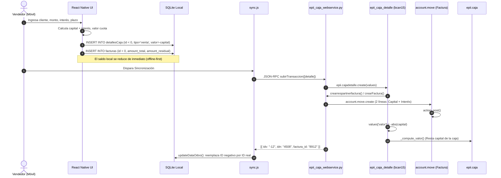
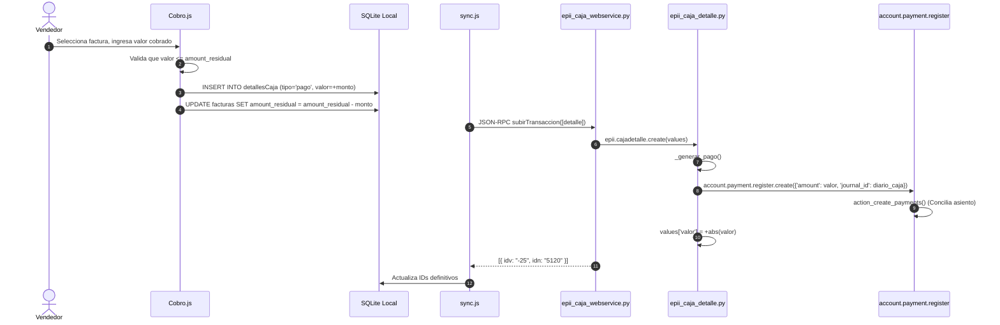
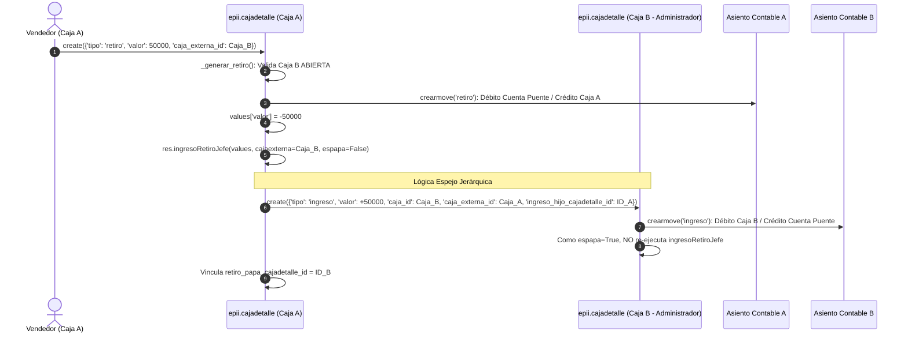

# Auditoría Integral de la Lógica Contable de Zenda
## Análisis Conjunto: React Native (Cliente Móvil) & Odoo (Backend) -> Especificación para Supabase

---

### Resumen Ejecutivo

Esta auditoría técnica reconstruye con precisión de código y trazabilidad bidireccional la arquitectura contable, financiera y operativa del ecosistema **Zenda**:
1. **Frontend Móvil (`bcan_movil_react`):** Aplicación React Native offline-first con base de datos SQLite preempaquetada (`Bcan.db`), IDs virtuales negativos temporales, cálculo determinístico de amortizaciones e intereses fijos, y cola de sincronización asíncrona hacia el backend.
2. **Backend Original Odoo (`cajas15-juan-diego` y `bcan15-odoo18`):** Módulos personalizados en Odoo 15/18 con endpoints JSON-RPC (`epii.caja.webservice`, `bcan.webservice`), modelo de libro de caja (`epii.caja`), movimientos de detalle (`epii.cajadetalle`), asientos contables automáticos (`account.move`), pagos conciliados (`account.payment` y `account.payment.register`), facturación de créditos y propagación jerárquica espejo (`ingresoRetiroJefe`).
3. **Destino de Migración:** Especificación completa para reescribir la lógica en **React Native + Supabase (PostgreSQL)**, eliminando la deuda técnica de Odoo, implementando atomicidad ACID mediante RPCs/Triggers y asegurando la jerarquía mediante Row Level Security (RLS).

---

## 1. Arquitectura y Mapa de Archivos Relevantes

```
┌────────────────────────────────────────────────────────┐
│               REACT NATIVE (Frontend Móvil)            │
│  - SQLite local (Bcan.db): cajas, facturas, detalles   │
│  - sync.js: orquestación de subida/bajada por lotes    │
│  - services.js: cliente HTTP JSON-RPC 2.0 a /jsonrpc   │
└───────────────────────────┬────────────────────────────┘
                            │
               Llamadas HTTP JSON-RPC 2.0
                            ▼
┌────────────────────────────────────────────────────────┐
│                   ODOO 15/18 (Backend)                 │
│  - Controllers: /jsonrpc router                        │
│  - epii_caja_webservice.py / bcan_webservice.py        │
│  - epii_caja.py: Libro de caja diario                  │
│  - epii_caja_detalle.py: Movimientos de caja           │
│  - account.move: Asientos y facturas de venta          │
│  - account.payment: Pagos de cartera conciliados       │
└────────────────────────────────────────────────────────┘
```

### Tabla de Archivos y Responsabilidades

| Componente | Archivo / Ruta | Responsabilidad Principal |
| :--- | :--- | :--- |
| **RN: Servicios RPC** | [`src/services/services.js`](file:///e:/React/Bcan/bcan_movil_react/src/services/services.js) | Envío de payloads JSON-RPC 2.0 a `/jsonrpc` invocando modelos de Odoo. |
| **RN: Sincronización** | [`src/utils/sync.js`](file:///e:/React/Bcan/bcan_movil_react/src/utils/sync.js) | Orquestación offline-first: subida de clientes, ventas, pagos, gastos, retiros; descarga y reconciliación de IDs. |
| **RN: Ventas** | [`src/screens/vendedor/NuevaVenta/NuevaVenta.js`](file:///e:/React/Bcan/bcan_movil_react/src/screens/vendedor/NuevaVenta/NuevaVenta.js) | Captura de clientes nuevos, cálculo de cuotas e inserción local de ventas. |
| **RN: Cobros / Pagos** | [`src/screens/vendedor/Cobro/Cobro.js`](file:///e:/React/Bcan/bcan_movil_react/src/screens/vendedor/Cobro/Cobro.js) | Registro de abonos a créditos, no-pagos (visita sin abono) y cálculo de saldo residual. |
| **RN: Resumen de Caja** | [`src/screens/vendedor/resumen/Componentes/itemResumen.js`](file:///e:/React/Bcan/bcan_movil_react/src/screens/vendedor/resumen/Componentes/itemResumen.js) | Consulta de movimientos del día, anulación y edición local de transacciones. |
| **Odoo: WebService Cajas** | `cajas15-juan-diego/models/epii_caja_webservice.py` | Métodos `subirTransaccion()`, `crearFactura()`, `crearFacturas()`, `retornoJsonFacturas()`. |
| **Odoo: Libro de Caja** | `cajas15-juan-diego/models/epii_caja.py` | Modelo `epii.caja`: saldo inicial, saldo final, validación de cajas abiertas/cerradas, reglas jerárquicas. |
| **Odoo: Detalle de Movimientos** | `cajas15-juan-diego/models/epii_caja_detalle.py` | Modelo `epii.cajadetalle`: `create()`, `write()`, `_generar_pago()`, `_generar_gasto()`, `_generar_ingreso()`, `_generar_retiro()`, `crearmove()`, `crearPago()`, `ingresoRetiroJefe()`. |
| **Odoo: WebService Cartera** | `bcan15-odoo18/models/bcan_webservice.py` | Métodos `obtenerCreditosVendedor()`, `obtenerHijoCajasBcan()`, `cancelar_factura()`, `crearrespartnerfactura()`. |
| **Odoo: Extensión Cartera** | `bcan15-odoo18/models/epii_caja_detalle.py` | Especialización de `epii.cajadetalle` para `venta`, `renovacion`, `nopago`, validación de unicidad y `button_delete()`. |

---

## 2. Análisis de Extremo a Extremo de Operaciones Financieras

### 2.1. Desembolso de Nuevo Crédito (`venta`) y Renovación (`renovacion`)



#### Recorrido Detallado:
1. **Acción UI:** Vendedor digita datos en `NuevaVenta.js` o `renovations.js`.
2. **Validaciones Cliente:** Valida `dineroLimiteEnVenta`, monto múltiplo de 1000, tasa de interés >= `minimoInteres`, selección de cuotas <= `maximoEnCuotas`.
3. **Cálculo Financiero:**
   $$\text{Monto Total Factura} = \text{Capital} + (\text{Capital} \times \text{Interés})$$
   $$\text{Valor Cuota} = \text{round}\left(\frac{\text{Monto Total}}{\text{Plazo Cuotas}}\right)$$
4. **Almacenamiento Local:** Inserta en `detallesCaja` con `valor = -abs(Capital)` y en `facturas`. El ID asignado es `id < 0` mediante `IdInsertion()`.
5. **Llamada Backend:** `subirTransaccion` en `epii.caja.webservice`.
6. **Ejecución Backend Odoo:**
   - En `bcan15-odoo18/models/epii_caja_detalle.py:create()` (L223-267):
     - Si es cliente nuevo, crea `res.partner`.
     - Llama a `epii.caja.webservice:crearFactura()` con 2 líneas: línea de producto `Prestamo` (cuenta de activo/cartera) y línea de producto `Interés` (cuenta de ingreso diferido/financiero).
     - Publica la factura (`action_post()`).
     - Asigna `values['valor'] = -abs(values['valor'])`.
     - Guarda el registro de `epii.cajadetalle`.
7. **Efecto Contable y en Cajas:**
   - La caja del vendedor resta el monto de capital entregado: $\Delta \text{Caja} = -\text{Capital}$.
   - Se crea una cuenta por cobrar en `account.move` por $\text{Capital} + \text{Interés}$.
8. **Respuesta y Reconciliación:** Odoo devuelve `{ idv: id_virtual, idn: id_odoo }`. El cliente ejecuta `updateDataOdoo()` reemplazando referencias foráneas en cascada.

---

### 2.2. Registro de Abono / Pago de Cuota (`pago`)



#### Recorrido Detallado:
1. **Acción UI:** Vendedor cobra en `Cobro.js`.
2. **Validaciones Cliente:** Monto > 0, valor abono no puede exceder el `amount_residual` de la factura.
3. **Cálculo Local:** Suma el abono a la caja local (`detallesCaja.valor = +monto`). Resta de `facturas.amount_residual`.
4. **Llamada Backend:** `subirTransaccion` con `tipo: 'pago'`, `pago_factura_venta_id: factura_id`, `valor: monto`.
5. **Ejecución Backend Odoo:**
   - En `epii_caja_detalle.py:create()` -> `_generar_pago()` (L201-210) -> `crearPago()` (L447-483).
   - Odoo crea un wizard `account.payment.register` asociado a la factura:
     ```python
     payment_register = self.env['account.payment.register'].with_context(
         active_model='account.move', active_ids=[mi_factura.id]
     ).create({ 'journal_id': journal_id, 'amount': valor })
     resultadopago = payment_register.action_create_payments()
     ```
   - Odoo genera un `account.payment`, crea las líneas contables en el diario de caja (Débito: Caja, Crédito: Clientes/Cartera) y **concilia automáticamente** el pago contra la factura.
   - Setea `fecha_ultimo_pago` y `valor_ultimo_pago` en la factura.
6. **Efecto Contable y en Cajas:**
   - Caja del vendedor: aumenta en el valor cobrado: $\Delta \text{Caja} = +\text{Abono}$.
   - Cartera de la factura: disminuye: $\Delta \text{amount\_residual} = -\text{Abono}$.

---

### 2.3. No Pago / Visita sin Cobro (`nopago`)

- **Acción:** El vendedor visita al cliente pero éste no tiene dinero o no se encuentra.
- **Cliente:** Registra en `detallesCaja` con `tipo: 'nopago'`, `valor: 0`, capturando coordenadas GPS y motivo.
- **Odoo (`bcan15-odoo18/models/epii_caja_detalle.py:269-284`):**
  - Valida estrictamente `if values["valor"] > 0: raise ValidationError('El Pago debe ser igual a 0')`.
  - No genera ningún apunte contable ni `account.payment`.
  - Actualiza la secuencia de ruta: `mispagos.res_partner_secuencia_pago = values["nopago_secuencia"]`.
- **Efecto en Cajas:** $\Delta \text{Caja} = 0$.

---

### 2.4. Gastos Operativos (`gasto`)

- **Acción:** El usuario registra compra de gasolina, papelería, etc.
- **Cliente:** Inserta en `detallesCaja` con `tipo: 'gasto'`, `valor: monto` (positivo en UI, pero resta saldo).
- **Odoo (`cajas15-juan-diego/models/epii_caja_detalle.py:187-200` y `341-420`):**
  - `_generar_gasto()` ejecuta `self.crearmove(tipo='gasto', valor=valor, producto=gasto_concepto_id, caja_id=caja_id, partner_id=partner_id)`.
  - `crearmove()` genera un asiento `account.move`:
    - **Línea Débito:** Cuenta de Gasto (asociada al producto/concepto o parametrización general). Monto: `abs(valor)`.
    - **Línea Crédito (Contrapartida):** Cuenta por defecto del Diario de la Caja (cuenta de caja/efectivo). Monto: `abs(valor)`.
    - Publica el asiento (`move.action_post()`).
  - Asigna `values["valor"] = -abs(values["valor"])` y guarda `gasto_asiento_id = move.id`.
- **Efecto en Cajas:** $\Delta \text{Caja} = -\text{Gasto}$.

---

### 2.5. Transferencias entre Cajas: Retiro e Ingreso Espejo (`ingresoRetiroJefe`)



#### Código Evidenciado (`cajas15-juan-diego/models/epii_caja_detalle.py:564-629`):
1. **Invocación:** Al crear un `TIPOINGRESO` o `TIPORETIRO` con `caja_externa_id` diferente a `caja_id`.
2. **Validación:** Odoo exige que `caja_externa` esté en `ESTADO_CAJA_ABIERTO`. Si está cerrada, arroja: `"Usuario no tiene caja abierta {id}-{name}"`.
3. **Generación del Par:**
   - Si en Caja A es `TIPORETIRO` ($\Delta \text{Caja A} = -V$):
     - En Caja B genera `TIPOINGRESO` ($\Delta \text{Caja B} = +V$).
     - Vincula `retiro_papa_cajadetalle_id` en A y `ingreso_hijo_cajadetalle_id` en B.
   - Si en Caja A es `TIPOINGRESO` ($\Delta \text{Caja A} = +V$):
     - En Caja B genera `TIPORETIRO` ($\Delta \text{Caja B} = -V$).
     - Vincula `ingreso_papa_cajadetalle_id` en A y `retiro_hijo_cajadetalle_id` en B.
4. **Condición de Parada de Recursión:** La llamada hija incluye `jefe_values['ingreso_hijo_cajadetalle_id'] = self.id`. Al crearse el registro del jefe, `espapa = bool(values.get("ingreso_hijo_cajadetalle_id"))` evalúa a `True`, lo que desactiva `ingresoRetiroJefe()` y previene bucles infinitos.

---

### 2.6. Anulación de Facturas / Créditos

- **Acción:** Vendedor anula una venta realizada por error desde el resumen.
- **Cliente:** Si no hay red, guarda en `deleteInvoice` con `estado: 'guardado'`.
- **Llamada RPC:** Invoca `bcan.webservice:cancelar_factura(json)`.
- **Backend Odoo (`bcan15-odoo18/models/bcan_webservice.py:583-605` y `epii_caja_detalle.py:381-398`):**
  - **Condición crítica de integridad:**
    ```python
    if len(factura._get_reconciled_payments()) == 0:
        factura.button_draft()
        factura.button_cancel()
        self.valor = 0  # o sube transacción compensatoria
        return True
    else:
        return {"errores": {"error": "No se puede cancelar una factura Con pagos"}}
    ```
  - Si la factura ya recibió al menos un abono, Odoo **rechaza terminantemente la anulación**.
  - Al anularse exitosamente, el valor en `epii.cajadetalle` pasa a `0` (o se anula el movimiento), con lo cual el capital prestado se reintegra conceptualmente al saldo de la caja.

---

## 3. Jerarquía de Usuarios y Reglas de Cajas

### 3.1. Estructura Jerárquica

La jerarquía en Odoo y React Native se organiza en forma de árbol mediante la relación `res.users.team_user_id`:
```
      [Administrador General / Dueño]
                   │
                   ▼ (team_user_id)
      [Administrador de Zona / Coordinador]
                   │
                   ▼ (team_user_id)
             [Vendedor / Cobrador]
```

### 3.2. Reglas de Validación de Cajas

| Regla | Ubicación en Código | Comportamiento Verificado |
| :--- | :--- | :--- |
| **Caja Superior Obligatoria para Operar** | `epii_caja.py:120-131` (`ponerCajaPapa`) | Un vendedor no puede mover caja si la caja de su jefe directo (`team_user_id`) no está en estado `ESTADO_CAJA_ABIERTO` en la misma fecha: `"no puede mover una caja sin tener la caja del papa abierta del mismo dia"`. |
| **Cierre de Caja Bloqueado por Subordinados** | `epii_caja.py:192-209` (`validarCajaCerradaAdministrador`) | Un administrador **NO puede cerrar su caja** si alguno de sus vendedores directos (`res_user_id.team_user_id == admin.id`) tiene su caja abierta: `"No puede cerrar la caja tiene vendedores abiertos"`. |
| **Límite de Cajas Simultáneas** | `epii_caja.py:159-186` (`validarCajasAbiertas`) | Un vendedor regular solo puede tener **1 caja abierta a la vez**. Un usuario con permiso de administrador puede tener hasta **2 cajas abiertas simultáneamente**. |
| **Continuidad de Saldos (Saldo Inicial)** | `epii_caja.py:132-136` (`calcularValorInicial`) | Al abrir una nueva caja, su `saldo_inicial` se asigna automáticamente del `saldo_final` de la última caja cronológica del mismo usuario y diario. |
| **Apertura y Cierre Masivo** | `epii_caja.py:210-269` | El backend permite abrir masivamente la caja del administrador y de todos sus vendedores dependientes. Para el cierre masivo, se ordenan por fecha e ID ascendente para cerrar primero las cajas hijas antes que la del padre. |

### 3.3. Matriz de Propagación de Movimientos entre Cajas

| Tipo de Movimiento | Caja del Vendedor | Caja del Administrador Inmediato | Asientos Contables (`account.move`) |
| :--- | :--- | :--- | :--- |
| **Venta (Préstamo nuevo)** | Resta Capital ($\Delta = -\text{Cap}$) | **No se crea movimiento** | Factura cliente `out_invoice` por $\text{Cap} + \text{Int}$. |
| **Renovación** | Resta Capital ($\Delta = -\text{Cap}$) | **No se crea movimiento** | Factura cliente `out_invoice`. Factura previa cancelada/reliquidada. |
| **Abono / Pago Cuota** | Suma Abono ($\Delta = +\text{Val}$) | **No se crea movimiento** | Asiento de cobro `account.payment` conciliado contra factura. |
| **Gasto Operativo** | Resta Gasto ($\Delta = -\text{Gasto}$) | **No se crea movimiento** | Asiento Débito Gasto / Crédito Caja. |
| **Retiro hacia Admin** | Resta Retiro ($\Delta = -\text{Val}$) | **Crea INGRESO automático** ($\Delta = +\text{Val}$) | Asiento en Caja Vendedor y Asiento en Caja Admin contra cta puente. |
| **Ingreso desde Admin** | Suma Ingreso ($\Delta = +\text{Val}$) | **Crea RETIRO automático** ($\Delta = -\text{Val}$) | Asiento en Caja Vendedor y Asiento en Caja Admin contra cta puente. |

> [!NOTE]
> **Aclaración Crítica de Jerarquía:** Las ventas, cobros y gastos del vendedor **NO crean registros individuales en la caja del administrador**. El administrador visualiza el consolidado y avance de sus subordinados mediante la función `bcan.webservice:obtenerHijoCajasBcan()`, la cual agrega dinámicamente: `ventaValor`, `pagoValor`, `gastoValor`, `saldoCartera` y `porcentajeCumplimiento`. Solo las transferencias de dinero físico (retiros e ingresos) generan movimientos espejo en la caja del superior.

---

## 4. Auditoría de Integridad y Detección de Inconsistencias

### 4.1. Análisis de Concurrencia y Sincronización Offline
1. **IDs Virtuales Negativos (`id < 0`):**
   - El cliente genera IDs autoincrementales negativos (`IdInsertion()` en `sync.js`).
   - Al sincronizar, Odoo crea los registros reales y responde con un mapa de traducción `[{ idv: "-1", idn: "105" }]`.
   - `updateDataOdoo()` reemplaza las claves primarias y foráneas en SQLite.
   - **Riesgo Detectado:** Si la aplicación falla a mitad del reemplazo de IDs en SQLite (ej. crash de batería o cierre forzado), la base de datos local puede quedar con llaves foráneas huérfanas apuntando a IDs negativos mientras la tabla padre ya tiene el ID definitivo.
2. **Duplicación por Reintentos de Red:**
   - En `epii_caja_webservice.py:subirTransaccion()`, Odoo itera sobre los registros recibidos sin una clave de idempotencia transaccional explícita (`idempotency_key` o `uuid`).
   - Si la petición HTTP se ejecuta en Odoo pero la respuesta se pierde por mala conectividad móvil, el cliente volverá a enviar los mismos movimientos en el siguiente intento de sincronización.
   - En `bcan15-odoo18/models/epii_caja_detalle.py:175-186`, existe una validación básica de duplicados por búsqueda:
     ```python
     if len(self.search(mi_search)) > 1:
         raise exceptions.ValidationError('Error El registro ya existe')
     ```
     Sin embargo, si los campos de búsqueda no coinciden con exactitud absoluta, pueden generarse pagos o gastos duplicados.

### 4.2. Inconsistencias y Hallazgos Contables

1. **Permisividad de Saldos Negativos en Odoo:**
   - En `epii_caja_detalle.py`, los retiros y gastos aplican `values["valor"] = -abs(values["valor"])`, pero en el backend Odoo **no existe un check constraint que impida que `saldo_final` caiga por debajo de cero**. La validación de saldo disponible recae exclusivamente en la interfaz móvil.
2. **Modificación Destructiva de Pagos:**
   - En `epii_caja_detalle.py:write()` -> `_modificar_pago()` (L290-307):
     ```python
     record.pago_payment_id.action_draft()
     record.pago_payment_id.with_context({'force_delete': True}).action_cancel()
     ```
     Al modificar el valor de un pago, el sistema cancela el `account.payment` original y genera uno completamente nuevo. Esto rompe la trazabilidad cronológica de auditoría contable (no queda registro del contra-asiento de corrección, sino un borrado lógico y recreación).
3. **Cálculo de Amortización:**
   - El sistema utiliza interés simple capitalizado sobre el monto principal:
     $$\text{Interés Total} = \text{Capital} \times \text{Tasa}$$
     No utiliza amortización francesa ni cálculo sobre saldos decrecientes. Las cuotas son cuotas fijas iguales:
     $$\text{Cuota} = \frac{\text{Capital} + \text{Interés Total}}{\text{Número de Cuotas}}$$
     Cualquier abono reduce directamente el `amount_residual` de la factura sin recalcular intereses futuros.

---

## 5. Evidencias de Código (Trazabilidad Extremo a Extremo)

| Regla de Negocio / Flujo | Archivo y Método en React Native | Archivo y Método en Odoo | Líneas Clave en Odoo | Clasificación |
| :--- | :--- | :--- | :--- | :--- |
| **Envío de Transacciones** | [`sync.js:subirTransacciones()`](file:///e:/React/Bcan/bcan_movil_react/src/utils/sync.js#L540) | `epii_caja_webservice.py:subirTransaccion` | L178-246 | **Confirmado** |
| **Creación Asiento Gasto** | [`sync.js:OrganizarGastos()`](file:///e:/React/Bcan/bcan_movil_react/src/utils/sync.js#L680) | `epii_caja_detalle.py:_generar_gasto` y `crearmove` | L187-200, L341-419 | **Confirmado** |
| **Conciliación de Pagos** | [`sync.js:OrganizarCobros()`](file:///e:/React/Bcan/bcan_movil_react/src/utils/sync.js#L600) | `epii_caja_detalle.py:_generar_pago` y `crearPago` | L201-210, L447-483 | **Confirmado** |
| **Transferencia Espejo Cajas**| [`sync.js:OrganizarRetiros()`](file:///e:/React/Bcan/bcan_movil_react/src/utils/sync.js#L710) | `epii_caja_detalle.py:ingresoRetiroJefe` | L564-629 | **Confirmado** |
| **Factura de Venta / Crédito**| [`sync.js:OrganizarClients()`](file:///e:/React/Bcan/bcan_movil_react/src/utils/sync.js#L750) | `bcan15/epii_caja_detalle.py:create` y `crearFactura` | L190-267, `epii_caja_ws:1052-1095` | **Confirmado** |
| **Anulación Factura sin Pagos**| [`services.js:cancelar_factura()`](file:///e:/React/Bcan/bcan_movil_react/src/services/services.js#L140) | `bcan_webservice.py:cancelar_factura` y `button_delete` | L583-605, `bcan15/epii_cd:381-398` | **Confirmado** |
| **Bloqueo Cierre Administrador**| N/A (validación server) | `epii_caja.py:validarCajaCerradaAdministrador` | L192-209 | **Confirmado** |
| **Validación Caja Padre Abierta**| N/A (validación server) | `epii_caja.py:ponerCajaPapa` | L120-131 | **Confirmado** |
| **Cómputo Saldo Caja** | `Resumen.js:consultarCaja()` | `epii_caja.py:_compute_valor` | L50-61 | **Confirmado** |

---

## 6. Especificación de Migración a Supabase (PostgreSQL)

Para migrar esta arquitectura a **React Native + Supabase**, se debe descartar el modelo pesado de Odoo y adoptar un esquema relacional optimizado con **PostgreSQL Functions (RPCs)** atómicas, **Row Level Security (RLS)** para control de acceso jerárquico y un mecanismo robusto de **Idempotencia**.

### 6.1. Esquema Relacional de Base de Datos (DDL)

```sql
-- 1. Perfiles de usuario y jerarquía
CREATE TABLE profiles (
    id UUID PRIMARY KEY REFERENCES auth.users(id) ON DELETE CASCADE,
    email TEXT NOT NULL,
    full_name TEXT NOT NULL,
    role TEXT NOT NULL CHECK (role IN ('superadmin', 'admin', 'coordinador', 'vendedor')),
    parent_id UUID REFERENCES profiles(id), -- Jerarquía team_user_id
    limit_cash NUMERIC(12, 2) DEFAULT 0.00,
    limit_sale NUMERIC(12, 2) DEFAULT 0.00,
    limit_expense NUMERIC(12, 2) DEFAULT 0.00,
    min_interest_rate NUMERIC(5, 2) DEFAULT 10.00,
    max_installments INTEGER DEFAULT 30,
    active BOOLEAN DEFAULT TRUE,
    created_at TIMESTAMPTZ DEFAULT NOW(),
    updated_at TIMESTAMPTZ DEFAULT NOW()
);

-- 2. Clientes
CREATE TABLE customers (
    id UUID PRIMARY KEY DEFAULT gen_random_uuid(),
    assigned_seller_id UUID NOT NULL REFERENCES profiles(id),
    identification TEXT NOT NULL UNIQUE,
    first_name TEXT NOT NULL,
    last_name TEXT,
    nickname TEXT,
    phone TEXT,
    address TEXT,
    neighborhood TEXT,
    latitude DOUBLE PRECISION,
    longitude DOUBLE PRECISION,
    payment_sequence INTEGER DEFAULT 0,
    active BOOLEAN DEFAULT TRUE,
    created_at TIMESTAMPTZ DEFAULT NOW(),
    updated_at TIMESTAMPTZ DEFAULT NOW()
);

-- 3. Cajas Diarias
CREATE TABLE cash_boxes (
    id UUID PRIMARY KEY DEFAULT gen_random_uuid(),
    user_id UUID NOT NULL REFERENCES profiles(id),
    box_date DATE NOT NULL,
    status TEXT NOT NULL CHECK (status IN ('abierto', 'cerrado')) DEFAULT 'abierto',
    initial_balance NUMERIC(12, 2) NOT NULL DEFAULT 0.00,
    current_balance NUMERIC(12, 2) NOT NULL DEFAULT 0.00,
    opened_at TIMESTAMPTZ DEFAULT NOW(),
    closed_at TIMESTAMPTZ,
    CONSTRAINT unique_user_open_box UNIQUE (user_id, box_date)
);

-- 4. Facturas / Créditos
CREATE TABLE invoices (
    id UUID PRIMARY KEY DEFAULT gen_random_uuid(),
    customer_id UUID NOT NULL REFERENCES customers(id),
    seller_id UUID NOT NULL REFERENCES profiles(id),
    box_id UUID NOT NULL REFERENCES cash_boxes(id),
    capital_amount NUMERIC(12, 2) NOT NULL CHECK (capital_amount > 0),
    interest_rate NUMERIC(5, 2) NOT NULL CHECK (interest_rate >= 0),
    interest_amount NUMERIC(12, 2) NOT NULL,
    total_amount NUMERIC(12, 2) NOT NULL,
    amount_residual NUMERIC(12, 2) NOT NULL,
    installments_count INTEGER NOT NULL CHECK (installments_count > 0),
    installment_amount NUMERIC(12, 2) NOT NULL,
    frequency TEXT NOT NULL CHECK (frequency IN ('diario', 'semanal', 'quincenal', 'mensual')),
    status TEXT NOT NULL CHECK (status IN ('posted', 'paid', 'cancelled')) DEFAULT 'posted',
    last_payment_date DATE,
    last_payment_amount NUMERIC(12, 2),
    created_at TIMESTAMPTZ DEFAULT NOW()
);

-- 5. Movimientos de Caja (Ledger)
CREATE TABLE cash_movements (
    id UUID PRIMARY KEY DEFAULT gen_random_uuid(),
    box_id UUID NOT NULL REFERENCES cash_boxes(id),
    invoice_id UUID REFERENCES invoices(id),
    type TEXT NOT NULL CHECK (type IN ('venta', 'renovacion', 'pago', 'nopago', 'gasto', 'ingreso', 'retiro')),
    amount NUMERIC(12, 2) NOT NULL, -- Positivo (ingreso/pago) o Negativo (venta/gasto/retiro)
    concept_description TEXT,
    external_box_id UUID REFERENCES cash_boxes(id),
    paired_movement_id UUID REFERENCES cash_movements(id), -- Movimiento espejo en transferencias
    latitude DOUBLE PRECISION,
    longitude DOUBLE PRECISION,
    client_uuid UUID UNIQUE, -- Clave de idempotencia para offline sync
    created_at TIMESTAMPTZ DEFAULT NOW()
);
```

---

### 6.2. Funciones RPC Atómicas en Supabase

#### A. Registro Atómico de Pagos (`rpc_register_payment`)
Garantiza en una sola transacción ACID la inserción del movimiento de caja, la adición del saldo y la reducción de la deuda de la factura:

```sql
CREATE OR REPLACE FUNCTION rpc_register_payment(
    p_box_id UUID,
    p_invoice_id UUID,
    p_amount NUMERIC(12, 2),
    p_client_uuid UUID,
    p_latitude DOUBLE PRECISION,
    p_longitude DOUBLE PRECISION
) RETURNS JSONB
LANGUAGE plpgsql
SECURITY DEFINER
AS $$
DECLARE
    v_box_status TEXT;
    v_residual NUMERIC(12, 2);
    v_movement_id UUID;
BEGIN
    -- 1. Verificar idempotencia
    IF EXISTS (SELECT 1 FROM cash_movements WHERE client_uuid = p_client_uuid) THEN
        RETURN jsonb_build_object('success', true, 'message', 'Pago ya procesado previamente');
    END IF;

    -- 2. Validar que la caja esté abierta
    SELECT status INTO v_box_status FROM cash_boxes WHERE id = p_box_id;
    IF v_box_status != 'abierto' THEN
        RAISE EXCEPTION 'La caja no está abierta';
    END IF;

    -- 3. Bloquear fila de la factura para evitar concurrencia
    SELECT amount_residual INTO v_residual FROM invoices WHERE id = p_invoice_id FOR UPDATE;
    IF v_residual IS NULL THEN
        RAISE EXCEPTION 'Factura no encontrada';
    END IF;

    IF p_amount <= 0 OR p_amount > v_residual THEN
        RAISE EXCEPTION 'Monto de pago inválido. Saldo pendiente: %', v_residual;
    END IF;

    -- 4. Insertar movimiento de caja
    INSERT INTO cash_movements (box_id, invoice_id, type, amount, client_uuid, latitude, longitude)
    VALUES (p_box_id, p_invoice_id, 'pago', p_amount, p_client_uuid, p_latitude, p_longitude)
    RETURNING id INTO v_movement_id;

    -- 5. Actualizar saldo de caja
    UPDATE cash_boxes
    SET current_balance = current_balance + p_amount
    WHERE id = p_box_id;

    -- 6. Actualizar factura
    UPDATE invoices
    SET amount_residual = amount_residual - p_amount,
        last_payment_date = CURRENT_DATE,
        last_payment_amount = p_amount,
        status = CASE WHEN (amount_residual - p_amount) = 0 THEN 'paid' ELSE 'posted' END
    WHERE id = p_invoice_id;

    RETURN jsonb_build_object(
        'success', true,
        'movement_id', v_movement_id,
        'new_residual', v_residual - p_amount
    );
END;
$$;
```

#### B. Transferencia Atómica entre Cajas (`rpc_cash_transfer`)
Replica con total seguridad la lógica de `ingresoRetiroJefe` sin fallos parciales:

```sql
CREATE OR REPLACE FUNCTION rpc_cash_transfer(
    p_source_box_id UUID,
    p_dest_box_id UUID,
    p_amount NUMERIC(12, 2),
    p_concept TEXT,
    p_client_uuid UUID
) RETURNS JSONB
LANGUAGE plpgsql
SECURITY DEFINER
AS $$
DECLARE
    v_source_status TEXT;
    v_dest_status TEXT;
    v_source_balance NUMERIC(12, 2);
    v_out_id UUID;
    v_in_id UUID;
BEGIN
    IF p_amount <= 0 THEN
        RAISE EXCEPTION 'El monto debe ser positivo';
    END IF;

    -- Verificar estados de ambas cajas
    SELECT status, current_balance INTO v_source_status, v_source_balance FROM cash_boxes WHERE id = p_source_box_id FOR UPDATE;
    SELECT status INTO v_dest_status FROM cash_boxes WHERE id = p_dest_box_id FOR UPDATE;

    IF v_source_status != 'abierto' OR v_dest_status != 'abierto' THEN
        RAISE EXCEPTION 'Ambas cajas deben estar abiertas para transferir dinero';
    END IF;

    -- Crear movimiento de Retiro (origen)
    INSERT INTO cash_movements (box_id, type, amount, concept_description, external_box_id, client_uuid)
    VALUES (p_source_box_id, 'retiro', -p_amount, p_concept, p_dest_box_id, p_client_uuid)
    RETURNING id INTO v_out_id;

    -- Crear movimiento de Ingreso (destino)
    INSERT INTO cash_movements (box_id, type, amount, concept_description, external_box_id, paired_movement_id)
    VALUES (p_dest_box_id, 'ingreso', p_amount, p_concept, p_source_box_id, v_out_id)
    RETURNING id INTO v_in_id;

    -- Enlazar movimiento par en origen
    UPDATE cash_movements SET paired_movement_id = v_in_id WHERE id = v_out_id;

    -- Actualizar saldos de ambas cajas
    UPDATE cash_boxes SET current_balance = current_balance - p_amount WHERE id = p_source_box_id;
    UPDATE cash_boxes SET current_balance = current_balance + p_amount WHERE id = p_dest_box_id;

    RETURN jsonb_build_object('success', true, 'retiro_id', v_out_id, 'ingreso_id', v_in_id);
END;
$$;
```

#### C. Validación de Cierre de Caja del Administrador (`rpc_close_box`)

```sql
CREATE OR REPLACE FUNCTION rpc_close_box(p_box_id UUID)
RETURNS JSONB
LANGUAGE plpgsql
SECURITY DEFINER
AS $$
DECLARE
    v_user_id UUID;
    v_open_subordinates INTEGER;
BEGIN
    SELECT user_id INTO v_user_id FROM cash_boxes WHERE id = p_box_id;

    -- Validar si algún subordinado directo tiene caja abierta
    SELECT COUNT(*) INTO v_open_subordinates
    FROM cash_boxes cb
    JOIN profiles p ON cb.user_id = p.id
    WHERE p.parent_id = v_user_id
      AND cb.status = 'abierto';

    IF v_open_subordinates > 0 THEN
        RAISE EXCEPTION 'No puede cerrar la caja: tiene % vendedor(es) subordinado(s) con caja abierta.', v_open_subordinates;
    END IF;

    -- Cerrar la caja
    UPDATE cash_boxes
    SET status = 'cerrado',
        closed_at = NOW()
    WHERE id = p_box_id;

    RETURN jsonb_build_object('success', true, 'message', 'Caja cerrada exitosamente');
END;
$$;
```

---

### 6.3. Políticas RLS (Row Level Security) Jerárquicas

Para reflejar la jerarquía en Supabase sin necesidad de servidores intermedios, se crea una función recursiva para comprobar descendientes:

```sql
-- Función helper para obtener todos los subordinados recursivos de un usuario
CREATE OR REPLACE FUNCTION get_subordinate_ids(p_user_id UUID)
RETURNS TABLE (subordinate_id UUID) AS $$
WITH RECURSIVE subordinates AS (
    SELECT id FROM profiles WHERE parent_id = p_user_id
    UNION ALL
    SELECT p.id FROM profiles p
    INNER JOIN subordinates s ON p.parent_id = s.id
)
SELECT id FROM subordinates;
$$ LANGUAGE sql STABLE;

-- Habilitar RLS en tablas
ALTER TABLE cash_boxes ENABLE ROW LEVEL SECURITY;
ALTER TABLE invoices ENABLE ROW LEVEL SECURITY;
ALTER TABLE cash_movements ENABLE ROW LEVEL SECURITY;

-- Política para Cajas: El usuario ve su propia caja y las de todos sus subordinados
CREATE POLICY "Users can view own and subordinate cash boxes"
ON cash_boxes FOR SELECT
USING (
    auth.uid() = user_id
    OR user_id IN (SELECT get_subordinate_ids(auth.uid()))
);

-- Política para Facturas: Vendedor ve sus facturas, Admin ve las de su equipo
CREATE POLICY "Users can view own and subordinate invoices"
ON invoices FOR SELECT
USING (
    auth.uid() = seller_id
    OR seller_id IN (SELECT get_subordinate_ids(auth.uid()))
);
```

---

## 7. Plan de Transición y Recomendaciones de Implementación

1. **Sustitución de SQLite Preempaquetado:** En la nueva app React Native, utilizar **WatermelonDB** o **PowerSync** sincronizado directamente con Supabase PostgreSQL mediante suscripciones WebSockets y Webhooks, reemplazando la base de datos precompilada en assets.
2. **Idempotencia Nativa:** Todos los payloads generados en el móvil deben incluir un `client_uuid` (UUIDv4) antes de almacenarse localmente. Este identificador se envía a Supabase y actúa como restricción única en `cash_movements`, eliminando al 100% el riesgo de movimientos duplicados por reintentos de red.
3. **Auditoría Estricta:** Reemplazar el comportamiento de Odoo de cancelar y recrear pagos por una tabla de `audit_logs` y transacciones compensatorias explícitas (asientos reversos).

---
*Fin de la especificación técnica de auditoría contable Zenda.*
